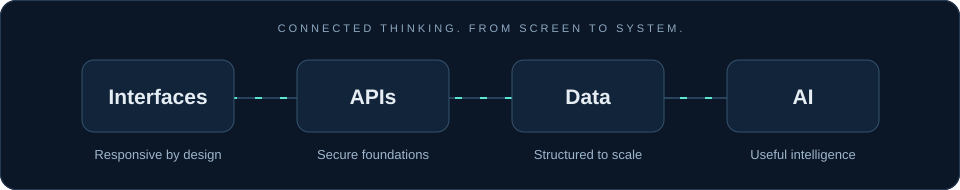
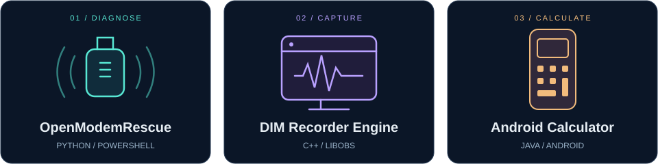
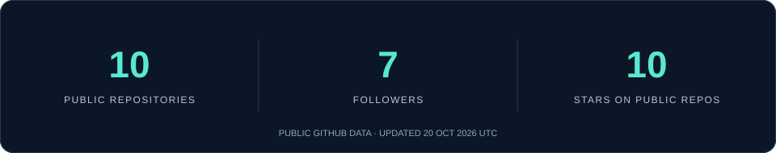
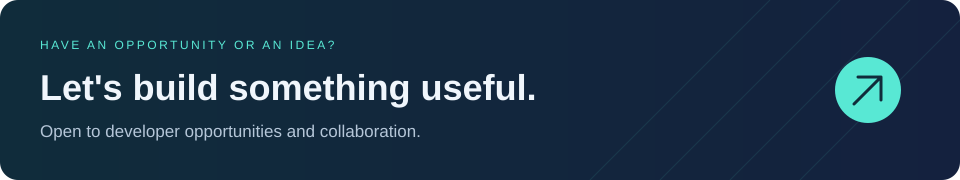

  <picture>
    <source media="(max-width: 600px)" srcset="assets/header-mobile.svg" />
    
  </picture>

<h1 align="center">Hi, I'm Geethika 👋</h1>

  <strong>Full-Stack Developer · AI-Integrated Systems · Sri Lanka</strong> 
  Building scalable, secure web applications with strong backend architecture 
  and practical AI-enhanced workflows.

  <a href="https://gdj.engineer/"><strong>Explore my portfolio ↗</strong></a>
  &nbsp; · &nbsp;
  <a href="https://drive.google.com/file/d/1iJIcGxIRB8idD3ZaoTovsnJ0_Ts07r-w/view?usp=sharing"><strong>View my CV ↗</strong></a>
  &nbsp; · &nbsp;
  <a href="mailto:A.l123jayarathna@gmail.com"><strong>Get in touch ↗</strong></a>

  <a href="#about-me">About</a> &nbsp; / &nbsp;
  <a href="#selected-projects">Projects</a> &nbsp; / &nbsp;
  <a href="#technology-stack">Stack</a> &nbsp; / &nbsp;
  <a href="#github-at-a-glance">GitHub</a> &nbsp; / &nbsp;
  <a href="#lets-connect">Contact</a>

---

## About me

I'm **Geethika Dilshan Jayarathna**, a developer from **Sri Lanka** who enjoys connecting polished interfaces with well-structured backend systems. My work spans modern web applications, secure APIs, database design, and AI integrations that make everyday workflows more useful.

I'm **currently seeking a developer opportunity** where I can contribute, learn with a team, and build software that solves real problems.

| At a glance | Details |
| :--- | :--- |
| 🎓 Education | Bachelor of Information Technology — **University of Colombo** |
| 💻 Development focus | Full-stack web development, backend architecture, and AI-integrated systems |
| 🧩 Engineering interests | API-first architecture, modular design, secure authentication, and data modeling |
| 🌱 Outside the editor | Learning, traveling, gaming, and PC building & repair |
| 📍 Based in | Sri Lanka |

### What I bring to a project

- **Interfaces that work across screens.** Responsive frontend development with Angular, React, Vue, and Tailwind CSS.
- **A strong backend foundation.** APIs and application services with Node.js, NestJS, Express, Laravel, and Symfony, including JWT and OAuth2 authentication.
- **Data with a clear structure.** Relational and document databases, query optimization, and caching with Redis.
- **Practical AI integration.** LLM-powered features, prompt engineering, and AI-assisted development workflows.
- **Attention to delivery.** Git-based collaboration, Docker containers, Linux environments, and Google Cloud.

  <picture>
    <source media="(max-width: 600px)" srcset="assets/engineering-mobile.svg" />
    
  </picture>

## Selected projects

A few public repositories to explore — from native applications to practical hardware tooling.

<picture>
  <source media="(max-width: 600px)" srcset="assets/selected-work-mobile.svg" />
  
</picture>

### 01 / OpenModemRescue

**A toolkit for understanding modem failures and planning recovery.**

Profile-based diagnostics for USB/LTE modems, with Windows and Linux tooling, report classification, and model-specific recovery guidance. The public CLI focuses on diagnostics, validation, and recovery planning.

`Python` `PowerShell` `Hardware diagnostics` `Windows & Linux`

[Explore the repository →](https://github.com/GDJ2001/OpenModemRescue)

---

### 02 / DIM Recorder Engine

**A native recording engine built around libobs.**

A windowless Windows x64 recording helper that communicates through a local named pipe and delivers preview frames through shared memory. This repository contains the native helper source and its build tooling.

`C++` `libobs` `Windows` `Inter-process communication`

[Explore the repository →](https://github.com/GDJ2001/dim-recorder-engine)

---

### 03 / Android Calculator

**An everyday calculator with a scientific side.**

A native Java application with a standard portrait layout and a scientific landscape layout. Includes operator precedence, trigonometric functions, light and dark themes, and calculation state preserved across device rotation.

`Java` `Android Studio` `Native Android` `Responsive layouts`

[Explore the repository →](https://github.com/GDJ2001/Calculator-Android-Studios) · [View releases →](https://github.com/GDJ2001/Calculator-Android-Studios/releases)

  <a href="https://github.com/GDJ2001?tab=repositories"><strong>Browse all public repositories ↗</strong></a>
  &nbsp; · &nbsp;
  <a href="https://gdj.engineer/"><strong>Visit my portfolio ↗</strong></a>

## Technology stack

The technologies I use across interfaces, application logic, data, and deployment.

### Languages & foundations

**JavaScript (ES6+) · TypeScript · PHP · SQL · HTML5 · CSS3**

### Frontend engineering

**Angular · React · Vue.js · Tailwind CSS · Vite** 
Responsive interfaces and component-based application development.

### Backend & APIs

**Node.js · NestJS · Express · Laravel · Symfony** 
REST APIs · JWT · OAuth2 · API-first architecture · Modular system design

### Databases & caching

**MySQL · PostgreSQL · MongoDB · SQLite · Redis** 
Data modeling · Raw SQL · Query optimization · Caching

### DevOps & cloud

**Google Cloud · Docker · Git · GitHub · Linux** 
Containerized applications, version control, and deployment workflows.

### AI & modern engineering

**LLM integration · Prompt engineering · GitHub Copilot** 
Connecting AI capabilities to applications and improving development workflows.

## GitHub at a glance

<a href="https://github.com/GDJ2001?tab=repositories">
  <picture>
    <source media="(max-width: 600px)" srcset="assets/github-overview-mobile.svg" />
    
  </picture>
</a>

  <a href="https://github.com/GDJ2001?tab=overview">Contribution activity ↗</a>
  &nbsp; · &nbsp;
  <a href="https://github.com/GDJ2001?tab=repositories">Repositories ↗</a>
  &nbsp; · &nbsp;
  <a href="https://github.com/GDJ2001?tab=followers">Community ↗</a>

## Let's connect

I'm looking for opportunities in **full-stack development, backend engineering, and AI-integrated applications**. If my work fits your team or project, I'd love to hear from you.

| Find me | Link |
| :--- | :--- |
| 🌐 Portfolio | [gdj.engineer](https://gdj.engineer/) |
| ✉️ Email | [A.l123jayarathna@gmail.com](mailto:A.l123jayarathna@gmail.com) |
| 📞 Phone | +94 786 878 622 |
| 📄 Curriculum vitae | [View my CV](https://drive.google.com/file/d/1iJIcGxIRB8idD3ZaoTovsnJ0_Ts07r-w/view?usp=sharing) |
| 💻 GitHub | [@GDJ2001](https://github.com/GDJ2001) |

  <a href="mailto:A.l123jayarathna@gmail.com">
    <picture>
      <source media="(max-width: 600px)" srcset="assets/footer-mobile.svg" />
      
    </picture>
  </a>

Built with curiosity, care, and a love for solving problems. · <a href="assets/CREDITS.md">Visual credits</a>

